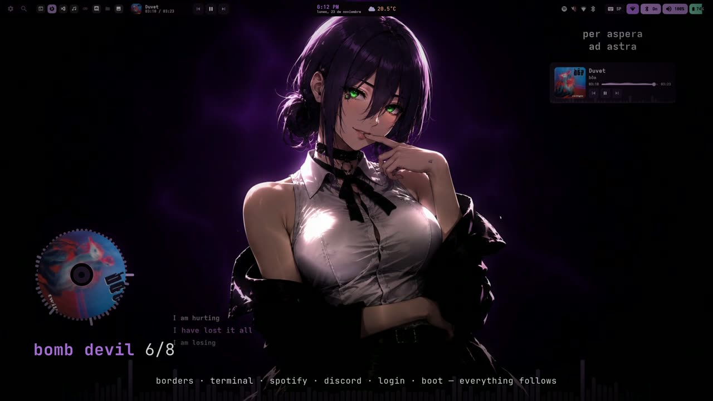
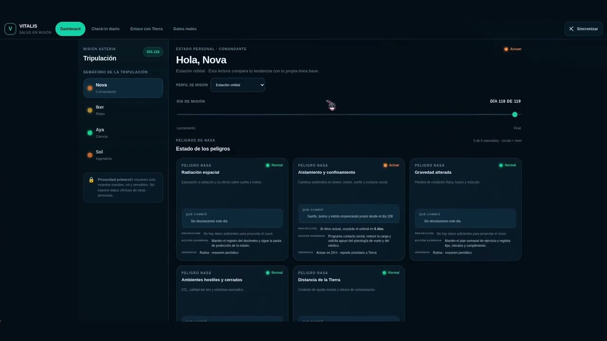
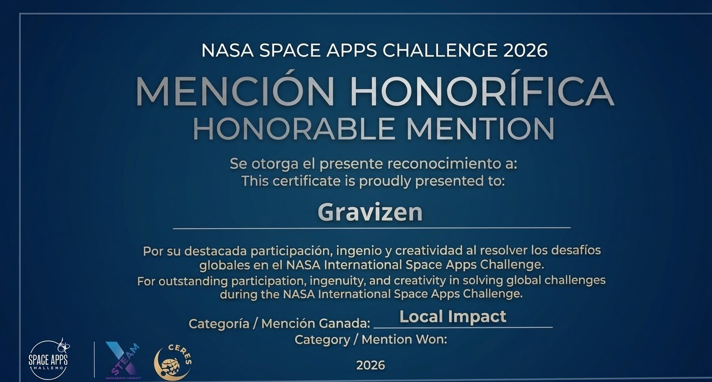

<div align="center">


**Brandon Hernández · Nuvi** — TSU en Desarrollo de Software Multiplataforma · Ingeniería ITIID en curso
Mención honorífica *Local Impact* — NASA Space Apps Challenge 2026

[](https://nuvix16.github.io/Portafolio-NuviX/)


</div>

## ✨ Qué tiene

- **Proyectos** con video: el bot de Discord, el escritorio NuviX, Vitalis (NASA Space Apps), Muelles Tepic como caso de estudio, PickUp&Seat e Inventario.
- **Selector de temas**: las 8 paletas de mi escritorio; cambian colores, estrellas y el anillo del avatar.
- **Español e inglés** con un clic (`data-i18n`).
- **Logros** con los certificados (NASA, Cisco).
- Sitio **estático**: sin frameworks ni build. Los videos usan `preload="none"` para no gastar datos.

<table>
<tr>
<td align="center" width="33%"><br><sub><b>Escritorio NuviX</b> · Arch + Hyprland</sub></td>
<td align="center" width="33%"><br><sub><b>Vitalis</b> · NASA Space Apps 2026</sub></td>
<td align="center" width="33%"><br><sub><b>Mención Local Impact</b></sub></td>
</tr>
</table>

## 🗂️ Estructura

```
index.html            todo el contenido (secciones y textos en ES/EN)
assets/
├── css/style.css     diseño, temas y animaciones
├── js/script.js      idioma, selector de temas, estrellas y animaciones al hacer scroll
├── img/              logo y avatar
├── video/            videos de los proyectos (720p) y sus portadas
└── certs/            certificados (imagen y PDF)
```

## 🚀 Verlo en local

```bash
git clone https://github.com/NuviX16/Portafolio-NuviX
cd Portafolio-NuviX
python -m http.server 8000   # y abre http://localhost:8000
```

Se publica solo con **GitHub Pages** desde `main`.

## 📬 Contacto

[GitHub](https://github.com/NuviX16) · [Instagram](https://www.instagram.com/nuvidev06) · [TikTok](https://www.tiktok.com/@nuvix2607)


